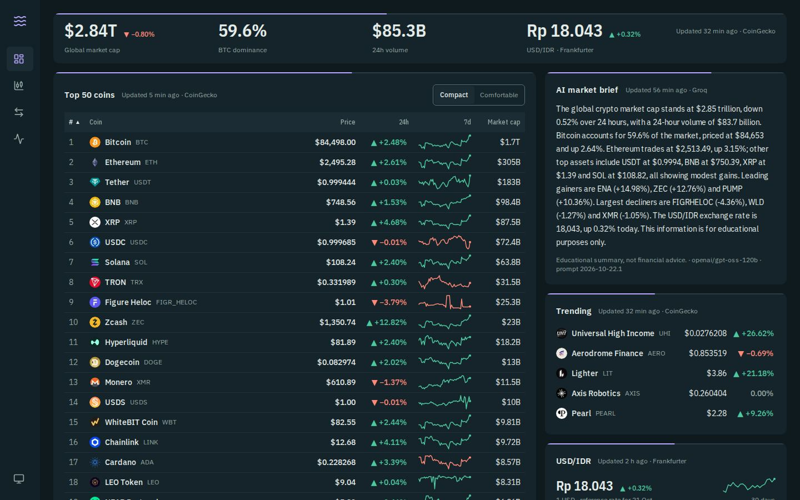
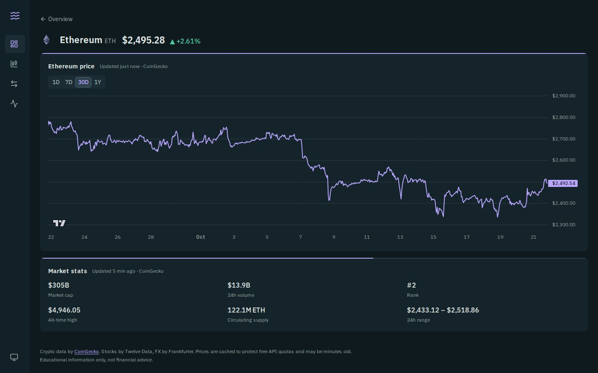
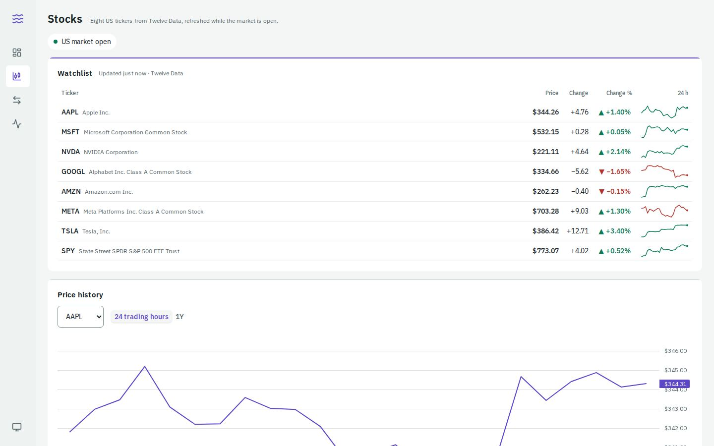
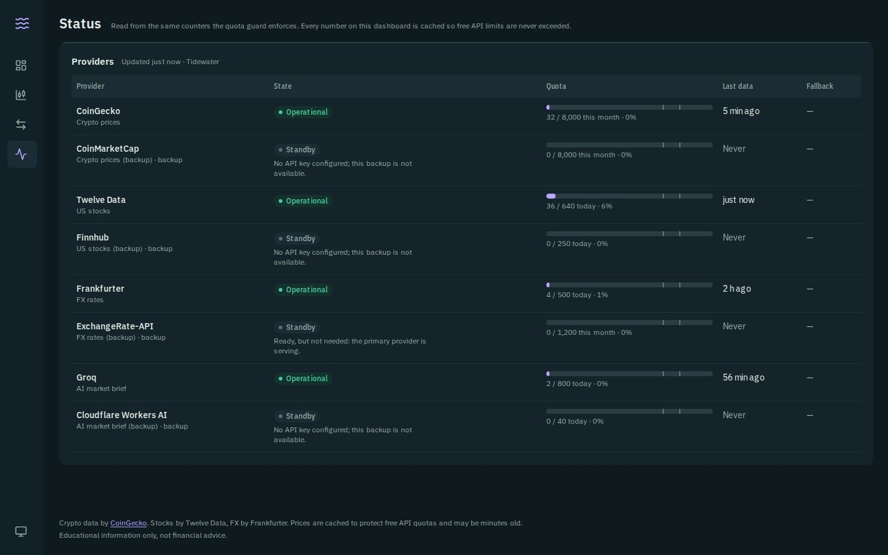
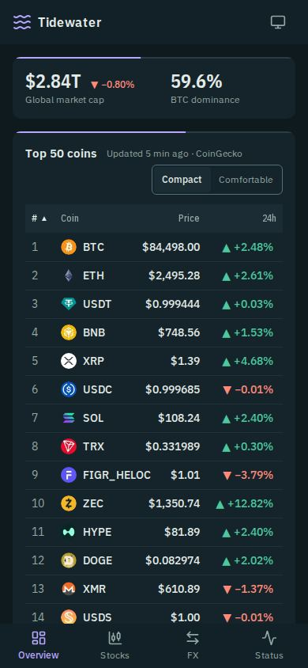
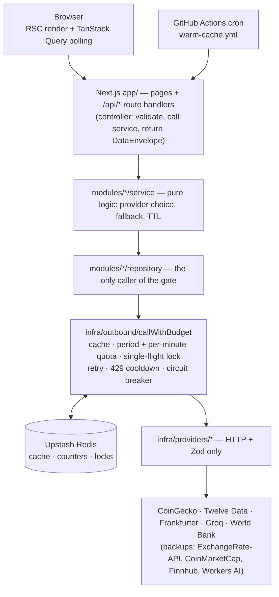

# Tidewater — crypto & market dashboard

Crypto markets, US stocks and FX rates in near-real-time, at **$0**, and **never over an API
limit**. Provider call volume is set by cache lifetimes, not by visitor count: every outbound call
goes through one server-side gate, `callWithBudget`, backed by Redis.

**Live:** <https://crypto-market-dashboard-beige.vercel.app> ·
**Status:** [/status](https://crypto-market-dashboard-beige.vercel.app/status) ·
**API:** [`docs/openapi.yaml`](docs/openapi.yaml)



|                   Coin detail                    |                 Stocks                 |            Provider status             |                     Phone                     |
| :----------------------------------------------: | :------------------------------------: | :------------------------------------: | :-------------------------------------------: |
|  |  |  |  |

## What it does

- **Overview** — Market Pulse (global cap, BTC dominance, 24 h volume, USD/IDR), the top 50 coins
  with 7-day sparklines (sortable, keyboard-navigable), trending coins, an AI market brief and the
  USD/IDR rate.
- **Coin detail** for the top 10 — 1D / 7D / 30D / 1Y charts and market stats.
- **Stocks** — 8 US tickers, refreshed only while the market is open; "opens 21:30 WITA" when closed.
- **FX** — converter and one year of USD rates.
- **Macro** — five annual World Bank indicators for Indonesia (GDP growth, inflation,
  unemployment, GDP per capita, current account) with the trend since 2010.
- **Status** — every provider's state, quota use against the enforced cap, data age and active
  fallback, read from the same counters the guard enforces.

Every panel shows **how old its data is and who served it** (the Freshness Rail) — the caching
architecture made visible.

## Architecture



Degradation order: **fresh cache → stale cache → backup provider → unavailable**. Browsers and
cron only ever talk to this app; dependency direction is enforced by ESLint.

## Quota calibration

`calls/day = Σ (86,400 ÷ TTL) × cache keys`. Caps are 80% of each free limit (`budgets.ts`); the
quota-compliance tests simulate 24 h of traffic and assert these numbers.

| Provider               | Data                                                                        | TTL                     |                   Calls / day | Free limit                          |            Peak use |
| :--------------------- | :-------------------------------------------------------------------------- | :---------------------- | ----------------------------: | :---------------------------------- | ------------------: |
| CoinGecko              | top 50 + sparklines; global; trending                                       | 15 min; 1 h; 1 h        |                  96 + 24 + 24 | 10,000 / month                      |                ~60% |
| CoinGecko              | 10 coins × (30 d, 1 y) charts; 7 d from sparklines                          | 6 h; 24 h               |                          ≤ 50 | (same)                              |              (same) |
| Twelve Data            | 8-ticker quotes at :00/:20/:40 while open                                   | slot-aligned            |                  ≤ 24 batches | 800 credits / day, 8 / min          | ≤ 256 credits (32%) |
| Twelve Data            | hourly bars at :05; daily bars after close                                  | slot-aligned            |                   ≤ 8 batches | (same)                              |              (same) |
| Frankfurter            | latest; 1-year range                                                        | 6 h; 24 h               |                         4 + 1 | no quota                            |                   — |
| Groq (`gpt-oss-120b`)  | AI brief, ~973 tokens                                                       | 3 h                     |                           ≤ 8 | 1,000 req · 200 K tokens / day      |          ~4% tokens |
| Finnhub (backup)       | 8 quotes + market status, only while Twelve Data has no fresh quotes        | 20 min open; 6 h closed | 0 (~216 in a full-day outage) | 60 / min (cap 250 / day)            |                   — |
| Workers AI (backup)    | AI brief (`llama-3.3-70b`), only while Groq has no fresh brief, ~38 neurons | 3 h                     |          0 (≤ 8 in an outage) | 10,000 neurons / day (cap 40 calls) |                ≤ 3% |
| CoinMarketCap (backup) | top 50, only while CoinGecko has no fresh data                              | 15 min                  |         0 (≤ 96 in an outage) | 10,000 credits / month              |                   — |
| World Bank             | 5 Indonesia indicators, one request                                         | 7 days                  |                         ≤ 1/7 | no published limit (cap 50/day)     |                   — |

Twelve Data batches cost 8 credits (one per symbol) and are counted as such; the guard refuses a
second batch in the same minute.

## Stack

Next.js 16 (App Router, Cache Components / PPR, Turbopack) · TypeScript strict · Tailwind CSS v4 +
shadcn/ui (restyled through the Tidewater tokens) · TanStack Query · Zustand · Zod · Upstash Redis ·
lightweight-charts (lazy) · Vitest · Testing Library · MSW · Playwright + axe · Lighthouse CI ·
Docker · GitHub Actions · Vercel.

## Run locally

```bash
cp .env.example .env.local      # keep MOCK_PROVIDERS=1: real captured fixtures, zero provider calls
npm ci
npm run dev                     # http://localhost:3000

docker compose up -d redis redis-http   # optional: real Redis (Upstash REST protocol) for integration tests
```

## Checks

```bash
npm run lint && npm run format:check && npm run typecheck && npm run check:tokens && npm run openapi:check
npm test                        # unit + integration (quota compliance, store contract)
npm run build && npm run test:e2e   # Playwright + axe against the production build
npx lhci autorun                # Lighthouse budgets (after a build)
```

CI runs all of the above on every PR, plus `npm audit` for runtime dependencies. Every PR gets a
Vercel preview with 10% budget caps; `main` deploys to production.

## Docs

- [`CLAUDE.md`](CLAUDE.md) — engineering rules for every Claude Code session
- [`docs/adr/`](docs/adr) — architecture decisions 0001–0010
- [`docs/security.md`](docs/security.md) — OWASP Top 10 mapping, rate limiting, privacy
- [`docs/runbook.md`](docs/runbook.md) — alerts, routines, secret rotation, rollback
- [`docs/openapi.yaml`](docs/openapi.yaml) — generated from the Zod contract
- [`docs/loom-script.md`](docs/loom-script.md) — the two-minute walkthrough
- [`docs/load-test.md`](docs/load-test.md) — k6: 50 users × 5 min, provider calls unchanged

Crypto data by [CoinGecko](https://www.coingecko.com/). Stocks by Twelve Data, FX by Frankfurter
(ECB reference rates), AI brief by Groq (backup: Cloudflare Workers AI), macro indicators by the
[World Bank](https://data.worldbank.org/) (CC BY 4.0). Charts by
[TradingView Lightweight Charts](https://www.tradingview.com/lightweight-charts/).
Educational information only, not financial advice.
